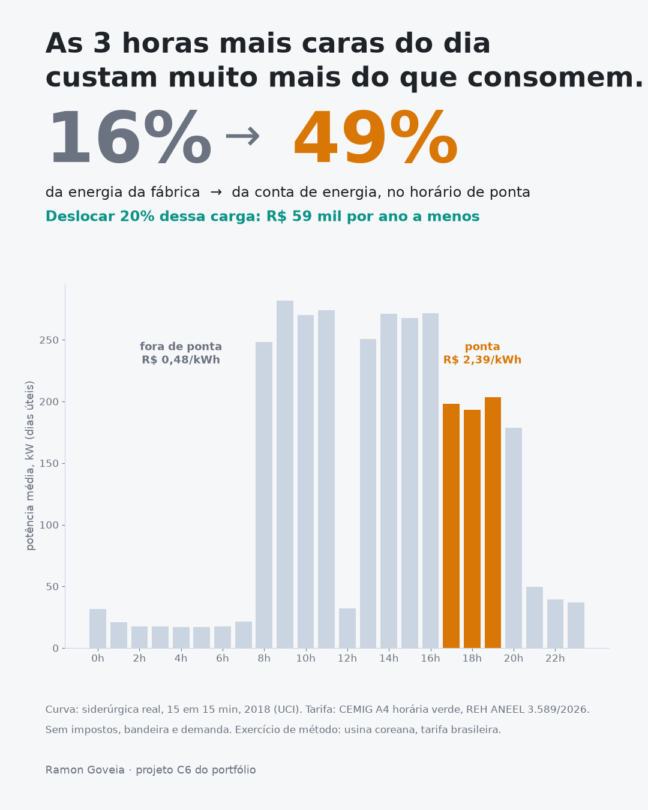

# As 3 horas mais caras do dia: 16% da energia, 49% da conta

**Na curva real de uma siderúrgica, com a tarifa horária verde A4 da CEMIG, o horário de
ponta concentra 16% da energia consumida e 49% da conta de energia. Deslocar 20% dessa
carga para outros horários do mesmo dia economiza R$ 59 mil por ano — 7,8% da conta.**

**[→ Abrir o painel do horário de ponta](https://goveiadev.github.io/c6-energia-horario-ponta/painel/)** —
escolha o período e a fração de carga que pode mudar de horário, e veja o dia típico antes e
depois, o ano inteiro hora a hora, a conta mês a mês e a tarifa oficial.



## A pergunta

Na tarifa horária do grupo A, a energia consumida das 17h às 20h dos dias úteis custa
várias vezes mais do que no resto do dia. **Quanto do que a fábrica paga vem dessas três
horas, e quanto ela economiza mudando parte da produção de horário, sem perder produção no
dia?**

## Os dados

- **Curva de carga:** [Steel Industry Energy Consumption](https://archive.ics.uci.edu/dataset/851/steel+industry+energy+consumption)
  (UCI Machine Learning Repository) — consumo real de uma siderúrgica (DAEWOO Steel,
  Gwangyang, Coreia do Sul), de 15 em 15 minutos, durante 2018: 35.040 registros, 960 MWh
  no ano, demanda máxima de 629 kW.
- **Tarifa:** [Tarifas homologadas das distribuidoras](https://dadosabertos.aneel.gov.br/dataset/tarifas-distribuidoras-energia-eletrica)
  (dados abertos da ANEEL) — CEMIG, subgrupo A4, modalidade horária verde, tarifa de
  aplicação do consumidor padrão, **Resolução Homologatória nº 3.589, de 26/05/2026**,
  vigente de 28/05/2026 a 27/05/2027. Salva em [`dados/tarifa_cemig.json`](dados/tarifa_cemig.json).

| CEMIG · A4 · verde | TUSD | TE | Total |
|---|---|---|---|
| Energia na ponta (R$/MWh) | 1.912,96 | 474,22 | **2.387,18** |
| Energia fora de ponta (R$/MWh) | 185,79 | 294,98 | **480,77** |
| Demanda (R$/kW) | 23,77 | — | 23,77 |

Na ponta, o kWh custa **5,0 vezes** o kWh fora dela.

**Ponta:** 17h às 20h nos dias úteis — o posto horário da CEMIG em contratos públicos de uso
do sistema de distribuição.

## O que eu fiz

1. **Separei a energia de ponta** na curva de 15 em 15 minutos: 3 horas por dia útil, 9% das
   horas do ano.
2. **Apliquei a tarifa oficial** a cada intervalo: ponta e fora de ponta, só energia (TUSD +
   TE), sem demanda, impostos nem bandeira.
3. **Simulei o deslocamento:** em cada dia útil, uma fração da energia de ponta vai para
   horários fora de ponta do mesmo dia, sem passar da demanda máxima que a fábrica já teve
   no ano. Na tarifa verde toda hora fora de ponta custa o mesmo, então não precisa de
   otimizador — a regra simples já dá o máximo.

| Carga de ponta deslocada | MWh por ano | Economia por ano | Da conta de energia |
|---|---|---|---|
| 10% | 15,5 | R$ 29,6 mil | 3,9% |
| **20%** | **31,1** | **R$ 59,2 mil** | **7,8%** |
| 30% | 46,6 | R$ 88,8 mil | 11,7% |
| 40% | 62,1 | R$ 118,5 mil | 15,6% |

Em nenhum cenário a folga fora da ponta foi limite: de madrugada e no almoço, a fábrica fica
muito abaixo da demanda máxima.

## O que isso significa

**A conta de energia não é proporcional ao consumo.** 16% da energia pesa 49% da conta. Quem
olha só o kWh total da fatura não vê onde está o dinheiro.

**Cada ponto de carga que sai da ponta vale o mesmo.** A economia cresce em linha reta com a
fração deslocada — R$ 2.960 por ano a cada ponto percentual, nesta fábrica. Isso facilita a
decisão: dá para comparar processo a processo com o custo de mudá-lo de horário.

**O primeiro passo é ver a curva.** Antes de qualquer projeto, a curva de carga de 15 em 15
minutos (que o medidor do grupo A já registra) e a tarifa homologada mostram quanto a ponta
pesa na conta da fábrica.

## Limitações

- **Usina coreana, tarifa brasileira.** A curva é de uma siderúrgica na Coreia do Sul em 2018;
  a tarifa e o horário de ponta são da CEMIG. É um exercício de método: a mesma conta vale
  para a curva de qualquer fábrica brasileira do grupo A.
- **A fração deslocável é premissa.** Forno contínuo não muda de horário; turno extra tem
  custo de pessoal (adicional noturno) e pode mexer em estoque e prazo. A economia é bruta.
- **Só energia, sem impostos e sem bandeira.** ICMS, PIS/Cofins e bandeiras aumentam a conta e
  a diferença em reais. A demanda contratada (R$ 23,77/kW na verde) fica fora — deslocar
  energia não a muda enquanto não criar pico novo.
- **Horário de ponta de contrato público, não da resolução.** O arquivo de tarifas da ANEEL
  não traz o posto horário; usei o que aparece nos contratos públicos de uso do sistema da
  CEMIG.
- **Um ano de curva, feriados não descontados** (e, se descontados, seriam coreanos).
- **Fábrica pequena.** 960 MWh por ano; em reais, a economia escala com o consumo de ponta de
  cada planta — o percentual da conta é o número que se transporta.

## Como rodar

```bash
python -m venv .venv
.venv/Scripts/pip install pandas numpy matplotlib jupyter
```

Baixe o zip da página da UCI acima e extraia `Steel_industry_data.csv` para `dados/`. A tarifa
já está em `dados/tarifa_cemig.json`, copiada da consulta à API da ANEEL
(`datastore_search` do recurso *tarifas-homologadas-distribuidoras-energia-eletrica*, filtros
`SigAgente=CEMIG-D`, `DscSubGrupo=A4`, `DscModalidadeTarifaria=Verde`, vigência mais recente).

```bash
.venv/Scripts/jupyter nbconvert --to notebook --execute --inplace analise.ipynb
```

**O painel** (`painel/`) é HTML estático, sem dependências externas. A execução do notebook
regrava `painel/dados.js`. Para abrir localmente:

```bash
python -m http.server 8000
# e abra http://localhost:8000/painel/
```

---

Ramon Goveia · [linkedin.com/in/ramon-goveia-92266443](https://www.linkedin.com/in/ramon-goveia-92266443) · projeto C6 de 16 do portfólio
